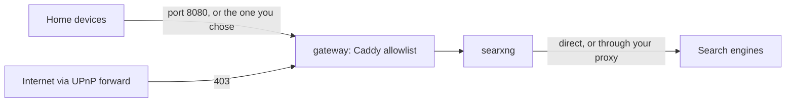

# SearXNG for your home network (DAppNode package)

`searxng-lan.public.dappnode.eth` runs [SearXNG](https://github.com/searxng/searxng), a private metasearch engine,
on your DAppNode so that **every device on your home network** can use it: phones, laptops, TV browsers.

- Open `http://dappnode.local:8080` (or `http://<your DAppNode's IP>:8080`) and search.
- Results come from Google, Bing, DuckDuckGo, Wikipedia and others, without ads, tracking or profiling.
- Thumbnails load through your DAppNode (image proxy), nothing is sent while you type (no autocomplete), and each
  install generates its own secret key.

## How it's built



- **DAppNode forwards every port a package publishes to the internet** through your router's UPnP. So the only
  published port belongs to a small gateway (Caddy), which answers **403** to every address outside the allowed
  ranges. It also refuses connections that Docker relays from its own bridge address (IPv6 and loopback), because
  those hide the real client.
- **SearXNG** (official image, pinned to a dated version) runs as an unprivileged user behind the gateway. Its settings
  live in the image and are applied on every start, so package updates take effect. Only the secret key is kept,
  in the `searxng-data` volume.
- Engines: SearXNG's defaults plus **Bing and Yahoo**. Upstream's default general engines are few, and Brave
  rate-limits quickly; Google's direct engine and Qwant stay disabled (access denied / CAPTCHA from home connections).
- Both containers run with all Linux capabilities dropped and `no-new-privileges`.

## Install

Install `searxng-lan.public.dappnode.eth` from the DAppStore. The install form asks for:

| Field | Default | Notes |
|---|---|---|
| Port on your home network | `8080` | See "If the port is taken" below. |
| Allowed networks | `10.0.0.0/8,172.16.0.0/12,192.168.0.0/16,172.33.8.0/22` | Comma-separated. Covers home networks and DAppNode's OpenVPN clients (`172.33.8.0/22`); WireGuard clients (`10.24.0.0/24`) are inside `10.0.0.0/8`. VPN access is untested by the maintainer. |
| Outgoing proxy | empty | Optional `http://host:port` or `socks5h://host:port` for the requests SearXNG sends to search engines. Empty = direct from your DAppNode. |

DAppNode doesn't trust this package's signing key by default (only DAppNode's and a few teams' keys are built in), so
the installer asks you to accept "bypass unsigned restriction". To verify releases instead, add the maintainer's key
under DAppNode's trusted release keys: name `cperezz.eth`, suffix `.public.dappnode.eth`, protocol `ECDSA_256`, key
`0x3211695ED0b0c277E7340dA9A6ED025463774797`.

### If the port is taken

8080 is a popular port. DAppNode doesn't check ports before installing, so if another package already uses it the
install fails with Docker's error, which names the port:

```
driver failed programming external connectivity on endpoint DAppNodePackage-gateway.searxng-lan.public.dappnode.eth
(…): Bind for 0.0.0.0:8080 failed: port is already allocated
```

DAppNode then rolls the install back ("Aborted and rolled back"); no containers are left, so there is nothing to
clean up. Install again and pick a different port in the form (for example `8090`). To change the port later, use
the package's **Network** tab in the DAppNode UI; that editor checks for collisions and rolls back if the port is
taken.

### Updates

When a new version is published, DAppNode offers it on the package page (or installs it automatically if you enabled
auto-updates). Your install-form values, the port and the secret key carry over; SearXNG's settings come from the new
image.

## Use it from your devices

- **Any browser:** `http://dappnode.local:<port>` or `http://<your DAppNode's IP>:<port>`. If a device ever gets a
  403 on `dappnode.local`, use the IP address: that device reached the node over IPv6, which Docker relays from its
  own address.
- **Firefox:** open the page, then in the address bar's search-engine menu choose *Add "SearXNG"*. Make it the default
  under Settings → Search.
- **Chrome / Edge:** open the page once and run a search; it then appears under Settings → Search engine → Manage
  search engines (site search). Choose *Make default*.
- **Brave (desktop):** `brave://settings/searchEngines` → *Site search* → **Add**: name `SearXNG`, URL
  `http://dappnode.local:<port>/search?q=%s` → ⋮ → *Make default*. (After one search on the page it may already be
  listed under inactive shortcuts: activate it.)
- **Brave (iPhone):** Settings → Search Engines → Standard Tab → *Add Custom Search Engine* with the same URL.
  **Brave (Android):** search once on the page, then pick it under Settings → Search engines → Standard tab.
- **iPhone / iPad Safari:** Safari doesn't allow custom search engines. Add the page to your home screen (Share →
  Add to Home Screen) or bookmark it.

## Development

Everything below runs on a DAppNode host (or any Docker host for the CI target).

```sh
# dev stack: same compose, DAppNode networks and aliases, gateway on host port 18080
docker compose -p sx-dev -f docker-compose.yml -f dev/compose.override.yml up -d --build
tools/verify.sh                     # all automated checks (TARGET=dev by default)
TARGET=package PORT=8080 tools/verify.sh   # against the installed package
tools/lan-check.sh <dappnode-ip> <port>    # from a laptop on the home network: page + OpenSearch on both addresses
docker compose -p sx-dev -f docker-compose.yml -f dev/compose.override.yml down -v   # before installing the package

# build and upload a release to the node's IPFS; install or update by hash in the DAppNode UI
docker run --rm --network dncore_network -v /var/run/docker.sock:/var/run/docker.sock -v "$PWD":/work -w /work \
  docker:29-cli sh -c "apk add --no-cache -q nodejs npm xz git && npx -y @dappnode/dappnodesdk@0.3.55 build --provider http://ipfs.dappnode:5001 --timeout 90min" </dev/null
```

`tools/leakcheck.sh all` must report clean before every push and release. It reads maintainer-specific patterns from
a file outside the repo.

CI runs the package build and `tools/verify.sh quick` on amd64 and arm64 for every push and pull request. A weekly
workflow opens a pull request when a newer SearXNG image is published; releases are published by hand.

## Releasing (maintainer)

Every published version is one mainnet transaction from the publisher address, which owns the package name.

1. Merge any pending SearXNG bump PR, raise `version` in `dappnode_package.json`, and check that
   `tools/leakcheck.sh all` is clean.
2. On the DAppNode host, build and upload with the command above. It prints the **unsigned** release hash. Then
   `tools/leakcheck.sh release build_searxng-lan.public.dappnode.eth_<version>` must report clean (with the
   maintainer's pattern file present on that host).
3. Print the message to sign. It lists one `file cid` line per release file, in dappmanager's exact format:
   ```sh
   mkdir -p /tmp/sign && cp tools/sign-release.mjs tools/package.json tools/sign.html /tmp/sign/
   docker run --rm --network dncore_network -v /tmp/sign:/app -w /app node:22-alpine sh -c \
     "npm install --no-audit --no-fund >/dev/null 2>&1 && node sign-release.mjs message <unsigned-hash> > message.txt"
   ```
4. Sign with the publisher's wallet. Serve `/tmp/sign` (`python3 -m http.server 8765`) and open
   `http://localhost:8765/sign.html?address=<publisher>` in the browser that has the wallet. Click *Sign*, then copy
   the signature.
5. Add `signature.json` to the release, pin it, and check the signer:
   ```sh
   docker run --rm --network dncore_network -v /tmp/sign:/app -w /app node:22-alpine sh -c \
     "node sign-release.mjs assemble <unsigned-hash> <signature> && node sign-release.mjs verify <signed-hash> <publisher>"
   ```
   `assemble` prints the **signed** hash; `verify` must print the publisher address.
6. Publish: open
   `https://dappnode.github.io/sdk-publish/?r=searxng-lan.public.dappnode.eth&v=<version>&d=<publisher>&h=/ipfs/<signed-hash>`,
   connect the publisher wallet and send the transaction. The first version calls `newRepoWithVersion` on the
   `public.dappnode.eth` registry; later ones call `newVersion` on the package's own repo contract. Check the target
   contract and the hash in the wallet before signing.
7. Tag the commit `v<version>` and push the tag.

Releases are pinned on the maintainer's DAppNode IPFS. While that node is offline, other nodes can't download them.

## License

MIT for this packaging (see `LICENSE`). SearXNG itself is AGPL-3.0; this package runs the unmodified upstream image
with a settings file.
